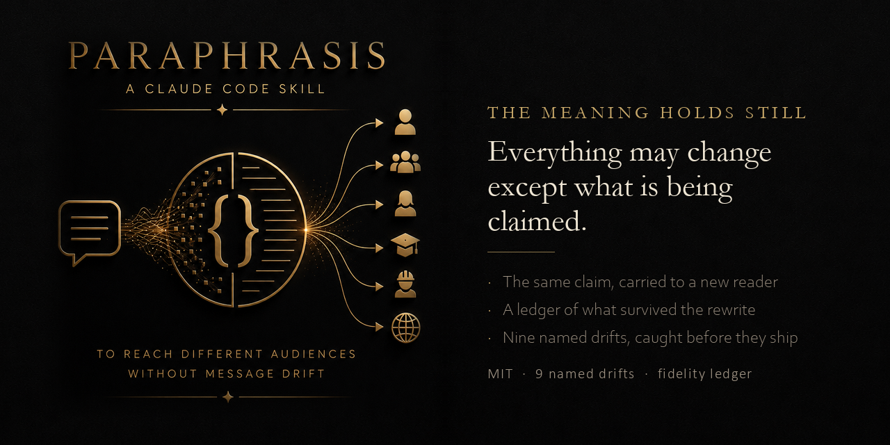

# Paraphrasis

**Say the same thing to a different audience, without the claim moving.**

An Agent Skill for Claude Code, Codex, Cursor, and other Agent-Skills-compatible tools.

---

## The gap this fills

Dryden drew the line and put the danger on one side of it. **Metaphrase** is word-for-word. **Paraphrase** is sense-for-sense, and once you stop moving words and start moving sense, nothing mechanical is left to check your work.

So a spec becomes an announcement, a finding becomes a landing page, nine hundred words become ninety, and somewhere in there the claim gets stronger. Nobody decided to overstate it. Restatement did that on its own.

Every writing tool improves prose. None of them watch the claim.

| Job | Words | Meaning | Characteristic failure |
|---|---|---|---|
| Compose | new | new | slop, dishonest persuasion |
| Edit | mostly kept | kept | voice theft, recomposition |
| **Restate** | **replaced on purpose** | **must not move** | **drift** |

## The axiom

**Everything may change except what is being claimed.**

| Free to change | Must survive unchanged |
|---|---|
| vocabulary, register, tone | claim strength |
| length, order, structure | scope and conditionality |
| examples, metaphors, framing | attribution and source |
| format, channel, medium | numbers and units |
| what to lead with | caveats and exclusions |

## The fidelity ledger

Returned with every restatement. It is the deliverable, not a courtesy.

```
IN   →  Three seats on three providers returned three different rankings
        from one fixed prompt (Exhibit A, 2026-08-15).

OUT  →  Ask three models the same question and you get three different
        answers. We logged it.

KEPT     three seats · three providers · three rankings · one prompt · logged
DROPPED  exhibit id, date  — recoverable from the source, not load-bearing here
ADDED    nothing
```

`ADDED` is the field that matters. Anything in the output with no ancestor in the input was invented, and inventing under a paraphrase reads as sourced. **A non-empty ADDED line is a stop, not a note.**

## Nine named drifts

Each one is what a *competent* writer produces when asked to say the same thing more clearly. That is why they are hard to catch.

- **Upgrade** — hedged becomes absolute. "seats disagreed" becomes "reaches better decisions"
- **Scope creep** — "in one logged run" becomes "consistently"
- **Quantifier slide** — some → most, up to → typically, can → does
- **Agency shift** — "can be configured to run locally" becomes "runs locally"
- **Evidence laundering** — the attribution drops and the claim floats
- **Compression loss** — under a word count the qualifier is the cheapest cut and the load-bearing one
- **Register inflation** — neutral → marketing → superlative, one restatement per step
- **Nominalisation** — "we measured X" becomes "X is proven"
- **Audience flattery** — restating for a buyer removes what the buyer would not enjoy

Two rules fall out of the catalog and are worth having even without the skill:

> **Cut examples before caveats.** If the caveat will not fit, the claim does not fit either. Pick a smaller claim.

> **Always restate from the source, never from the last restatement.** Register inflation walks a claim four steps from where it started, and every single step looks reasonable.

## The reversal test

Paraphrase the output back toward the input. Is the round trip stronger than the original? Weaker is usually fine. **Stronger never is.**

## The claims rail

If the project has a claims file, the output is checked against it before returning. Restatement is the exact moment a barred claim re-enters approved copy, because nobody re-checks a rewrite of something already approved.

## Install

```
/plugin marketplace add Pr1m4lc0d3/paraphrasis
/plugin install paraphrasis
```

Or copy `skills/paraphrasis/` into your `.claude/skills/` folder.

## Related

- **[peitho](https://github.com/Pr1m4lc0d3/peitho)** — the prose pass on the output. This skill holds the meaning still; Peitho makes the sentences read. Where they disagree, fidelity wins and Peitho gets the next pass.
- **[metaphrasis](https://github.com/Pr1m4lc0d3/metaphrasis)** — the mirror. That one crosses a medium literally; this one crosses an audience faithfully.
- **[janus](https://github.com/Pr1m4lc0d3/janus)** — when two audiences must be told two opposed things and both must stay true.

## License

MIT. See [LICENSE](LICENSE).
